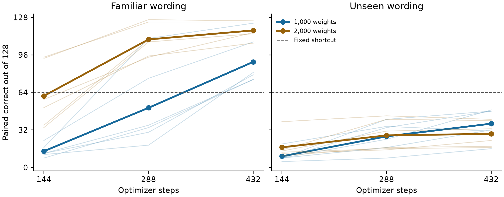

# Tiny Weight Rule Learning

How many trainable weights does a language model need to learn a newly assigned rule? We trained two copies of Qwen2.5 0.5B on identical synthetic parcel records with opposite routing rules. At test time, we withheld the rulebooks and counted a parcel as correct only when both copies followed their own rule.

[Paper (PDF)](paper/tiny-weight-rule-learning.pdf) · [Manuscript](paper/draft.md) · [Verified results](results/confirmatory/report/tables.md) · [Reproduce the study](REPRODUCING.md)

## What happened

The strongest fixed shortcut scored **64/128**. On familiar wording, all six rulebook-and-mask pairs beat it by **288 steps with 2,000 weights** and by **432 steps with 1,000 weights**. The paired scores fell below the shortcut on the same parcels with unseen wording.

| Trainable weights | Familiar pairs above 64/128 at 288 steps | Mean familiar score at 432 steps | Mean unseen score at 432 steps |
| ---: | ---: | ---: | ---: |
| 1,000 | 2 of 6 | 90.0/128 | 37.3/128 |
| 2,000 | 6 of 6 | 116.8/128 | 28.7/128 |



In the three adaptation comparisons that reached comparable final performance, excess description length was lowest when starting with the target rule and highest when starting with the opposite rule. The [EDL table](results/confirmatory/report/edl-conditions.csv) includes the fourth comparison and its endpoint flag.

All **58 study fits** and **two replay fits** passed verification. The replay produced identical logits at all three checkpoints for the repeated pair. These findings cover one base checkpoint, three four-depot rulebooks, two sparse masks, and one unseen wording. The paper also reports the exploratory composition, rulebook-size, and cross-model runs.

## Quick start

Preview the full job schedule with Python 3.13. The dry run needs only the standard library.

```sh
python -B experiments/run_confirmatory.py run --dry-run --draw 90101 90102 90106
```

## Repository layout

| Path | Contents |
| --- | --- |
| [`experiments/`](experiments/) | Data generation, training, verification, replay, and reporting |
| [`results/confirmatory/`](results/confirmatory/) | Frozen inputs, checksummed verification summaries, CSV tables, and figures |
| [`paper/`](paper/) | Manuscript, PDF, and rendering scripts |
| [`REPRODUCING.md`](REPRODUCING.md) | Pinned environment, checkpoint, commands, and archive verification |
