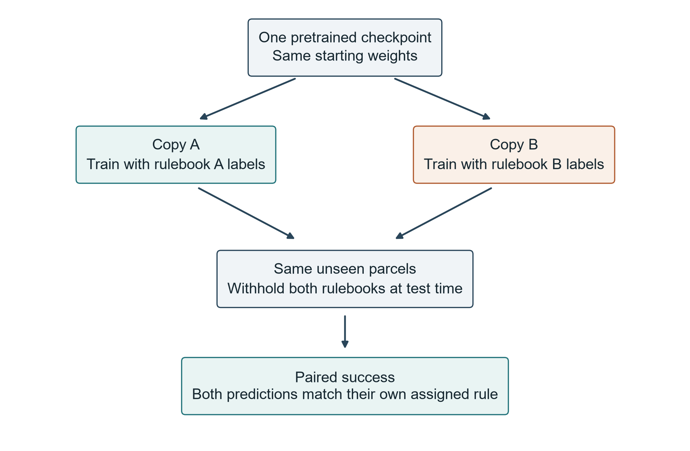
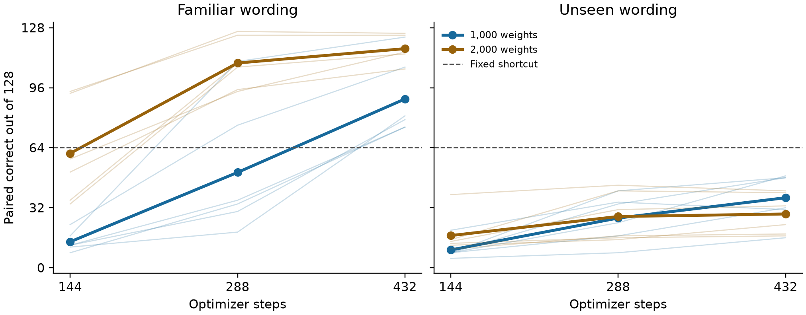
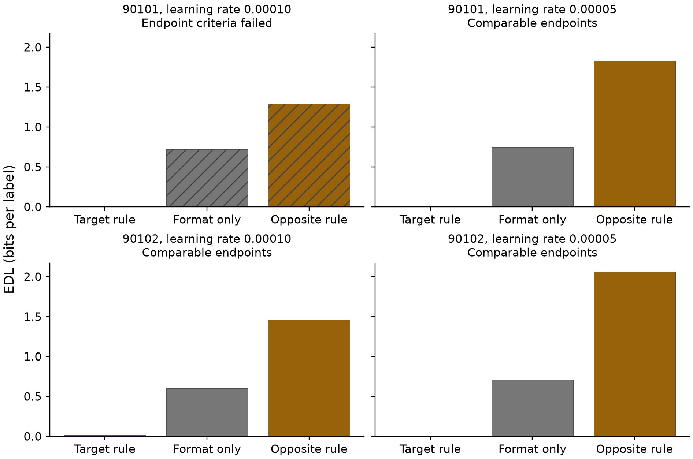
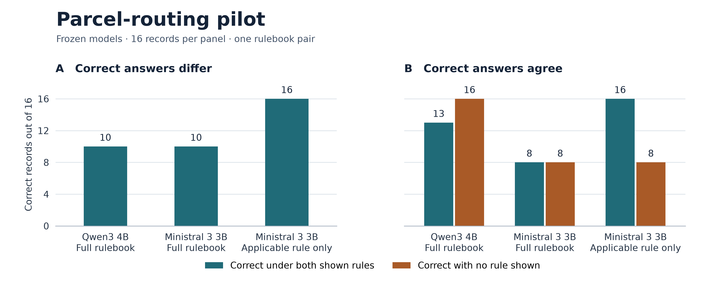
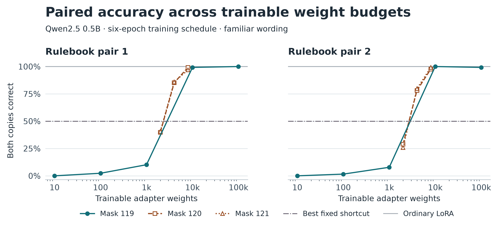
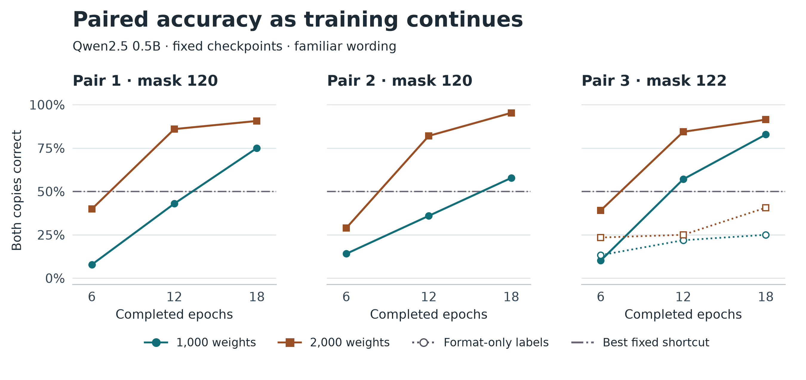
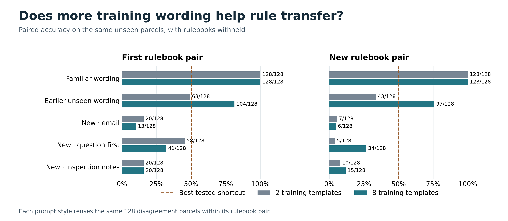
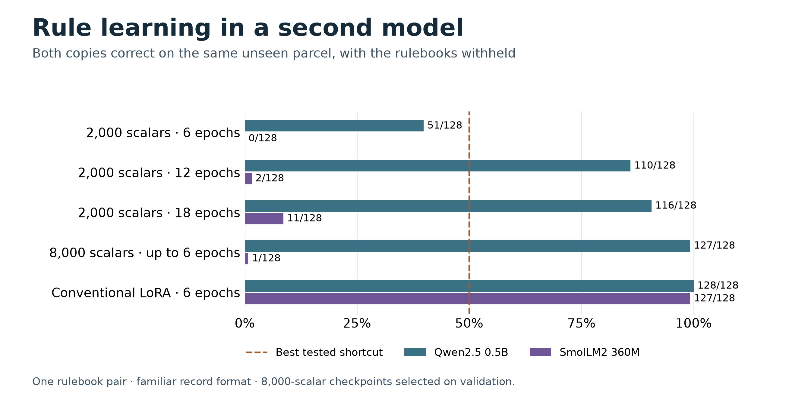

# When Do Tiny Weight Updates Teach a New Rule?

Yashar Meidani

## Abstract

We study how trainable weight count and optimization time affect learning a newly assigned rule. Two copies of Qwen2.5 0.5B train on identical parcel records with labels from complementary routing rulebooks. At test time, both copies must follow their own assignments on the same unseen parcels with the rules withheld. Across three rulebook pairs and two masks, 2,000 trainable adapter weights exceeded a 64/128 shortcut in all six comparisons after 288 optimizer steps. With 1,000 weights, two of six comparisons exceeded the shortcut at 288 steps and all six did at 432 steps. At 432 steps, every sparse run scored below the shortcut when the same parcels used unseen wording. In three comparisons with comparable final performance, excess description length was lowest after exposure to the target rulebook, higher after format-only exposure, and highest after exposure to the opposite rulebook. The results quantify how budget, training duration, and prompt wording affect paired rule learning in this task.

## 1. Introduction

Capability evaluations sometimes fine-tune a language model before testing it. An improved score can reflect knowledge acquired during the evaluation, a change in the model's ability to use prior knowledge, or both. We isolate one source of new information by drawing task assignments after selecting the checkpoint and giving two copies different assignments through training labels.

Prior work estimated how much of a fine-tuning gain could be recovered by updating randomly selected parameters [1]. Follow-up work used excess description length (EDL) to quantify how models learn from labels under different starting conditions [2]. Our experiment holds the checkpoint, task, and input records fixed within each pair while changing which answer is correct on disagreement parcels. Both copies can succeed on a disagreement parcel only when their answers follow their respective assignments.

We ask how many trainable adapter weights the model needs to clear a fixed shortcut by a given optimizer step, whether the resulting behavior transfers to new wording, and how the cost of learning changes with prior exposure. The confirmatory four-depot study is the primary comparison. Earlier experiments explored wording diversity, rulebook size, composition, and other checkpoints.

## 2. Methods

### 2.1. Rulebooks, records, and scoring

Each synthetic parcel contains a depot, a printed lane, a scanned lane, and two answer options. A rulebook specifies which lane field to use at each of four depots. Rulebook A assigns two depots to each field. Rulebook B reverses all four assignments. Copies A and B see the same records in the same order and start from the same checkpoint and adapter initialization, with labels determined by their respective books. Figure 1 summarizes the matched design.

**Figure 1.** Both copies start from the same checkpoint and train on identical records. The labels reflect the assigned rulebook. The test uses the same unseen parcels for both copies and withholds both rulebooks.

Each confirmatory draw has 384 training records, 96 validation records, and 192 test records from disjoint lane ranges. The test contains 128 disagreement parcels, on which the fields differ, and 64 agreement parcels, on which either field gives the correct lane. We balance the correct option position within each depot and parcel type. Training uses templates 0 and 1. We render the same held-out parcels in familiar template 0 and unseen template 2, with both rulebooks withheld.

We choose the higher of the two legal answer-token logits and break ties in favor of A. The primary metric counts disagreement parcels on which both copies are right. We report agreement cases separately in the result files. We test every pair of fixed answer policies drawn from always A, always B, always printed, and always scanned. The best such pair scores 64/128 on disagreement parcels in each draw.

### 2.2. Confirmatory weight budgets and duration

We selected three four-depot rulebook draws, with seeds 90101, 90102, and 90106, covering all three ways to partition four depot positions into two unordered field groups. Each draw uses distinct depot names. Before training, we saved the rulebooks, ordered splits, mask coordinates, checkpoint hashes, settings, and analysis definitions in a SHA-256 manifest.

We used the same pinned Qwen2.5 0.5B checkpoint in bfloat16 throughout the confirmatory runs. In each sparse pair we froze the backbone and the rank-8 adapter A matrices. The selected B coordinates started at zero. We trained either 1,000 or 2,000 B scalars with alpha 16. Both copies used the same mask, and the 1,000 coordinates were nested inside the 2,000 for each mask seed. We crossed all three draws with mask seeds 123 and 124. The frozen A basis seed was 119 and the training-order seed was 42. AdamW used a 0.01 learning rate, zero weight decay, and batches of 16. We scored fixed checkpoints at 144, 288, and 432 optimizer steps, corresponding to 6, 12, and 18 epochs. This yielded 24 sparse training fits.

As a positive control, we trained six ordinary rank-8 LoRA adapters, two per draw. These trained both A and B matrices on attention and feed-forward projections with alpha 16, a learning rate of 0.0001, batches of eight, and six epochs. We report each sparse draw and mask separately. For ranges across rulebooks, we first average the two masks within each draw.

### 2.3. Excess description length

On draws 90101 and 90102, we compared three initial adapters for each copy. The target condition used its ordinary LoRA adapter trained on the target rulebook. The format-only adapter used the same exposure records, initialization, and schedule, with labels changed on disagreement parcels. Within each depot, template, and printed-answer position, half of the disagreement labels selected each field. Agreement parcels kept their correct labels. The opposite condition reused the other copy's ordinary adapter.

Each condition adapted to the target rulebook for six epochs in batches of eight, at either 0.00010 or 0.00005. Both rates used identical starting adapters and example order. Each draw used 384 adaptation records, 96 validation records, and 384 held-out records from lane ranges disjoint from exposure. There were 288 disagreement parcels in each held-out set. Four format-only exposure fits and 24 adaptation fits brought the study total to 58.

Following the prequential coding approach of [2], we record the full-vocabulary negative log probability of each correct label in the first epoch, before each batch update. EDL per label is the mean first-pass loss minus the mean final held-out loss, divided by ln 2 to convert nats to bits. We average across the two copies. For a draw and learning rate, we treat the three endpoints as comparable if every condition reaches at least 274/288 paired disagreement accuracy and the spread in mean final loss is at most 0.05 bits per label. We report every comparison and flag any that fail either check.

### 2.4. Exploratory pilot and scalar sweep

The inference pilot used an earlier 32-record dataset and one rulebook pair. It compared frozen Qwen3 4B and Ministral 3 3B with the full rulebook shown. A follow-up reused the records and showed Ministral only the rule applicable to each record. The pilot parsed generated answers and counted invalid outputs as incorrect. The fine-tuning experiments used the two-token scoring procedure from Section 2.1.

For the initial fine-tuning runs, we used Qwen2.5 0.5B in bfloat16. Ordinary low-rank adaptation (LoRA) trained rank-8 adapters with alpha 16 on the attention and feed-forward projections. The first pair used a learning rate of 0.0005 and was unstable on validation. We report the retry at 0.0001 as the ordinary LoRA reference. It used six epochs and batches of eight.

In the sparse runs, we froze the backbone and the adapter A matrices. We initialized the selected B coordinates to zero and trained only those scalars. Budget masks shared a fixed A basis and were nested within each mask seed. Matched copies shared their mask and data order. Sparse runs used AdamW with a learning rate of 0.01, zero weight decay, and batches of 16. We ran two initial rulebook pairs and verified the changed-coordinate counts. The six-epoch sweep reports the earliest shared checkpoint with the highest paired disagreement score on validation. A separate full-B comparison used a learning rate of 0.001.

### 2.5. Exploratory training duration and format-only control

For 1,000 and 2,000 trainable weights, we recorded results at fixed epochs 6, 12, and 18, corresponding to 144, 288, and 432 optimizer steps per copy. On the two original pairs, both budgets used nested masks from seed 120. We then used the third distinct balanced rulebook pair, a new nested mask from seed 122, and test lane codes drawn from 900 to 999. We kept the checkpoint, frozen adapter basis, optimizer, batch size, training seed, and score definition fixed.

For each budget on the third pair, we trained a matched format-only control. Agreement parcels retained their correct labels. Within each depot and printed-option position, half of the disagreement records used the printed lane and half used the scanned lane, with the subsets randomized independently for the two copies. The two fields were therefore equally predictive in those groups. This retains practice with the records, legal labels, and field selection while withholding the target association between depot and lane field. We evaluate both conditions against the true rulebooks at the same fixed epochs. An ordinary LoRA pair provides a reference on the third split.

### 2.6. Exploratory wording, rulebook size, composition, and models

The wording experiment compared two and eight training templates for each of the first two rulebook pairs. We evaluated both arms on the same held-out parcels under familiar wording, an earlier unseen template, and three additional unseen templates. We report each template separately.

We tested SmolLM2 360M on the same split as the first Qwen2.5 pair. We compared ordinary LoRA, 2,000 weights for 18 epochs, and 8,000 weights under the six-epoch schedule. Qwen3 4B and Ministral 3 3B each ran one epoch of rank-8 LoRA with a frozen 4-bit NF4 backbone, batches of eight, and a learning rate of 0.0005. Those larger-model runs measured whether training fit on an 8 GB RTX 4060 and whether a short run learned the assignments.

An eight-depot study used schedules that matched either total training records or distinct records per depot against a four-depot reference. A composition task paired depot and package-class rules and held out combinations of the two. Ordinary LoRA trained either directly on combinations or on component rules followed by combinations. The staged sparse runs used the same phase order.

## 3. Results

### 3.1. Confirmatory weight budget, duration, and wording

At 144 steps, zero of six 1,000-weight pairs and two of six 2,000-weight pairs exceeded the familiar-wording shortcut. At 288 steps, the corresponding counts were two of six and six of six. At 432 steps, both budgets exceeded the shortcut for all six draw-mask pairs. The 2,000-weight mask scored higher than its nested 1,000-weight counterpart at every familiar-wording checkpoint. The increase from 144 to 432 steps ranged from 63 to 106 paired successes at 1,000 weights and from 30 to 81 at 2,000 weights. Figure 2 shows the trajectories.

**Table 1.** Paired disagreement counts out of 128 at 144, 288, and 432 optimizer steps. Each row reports one pair of complementary assignments. The shortcut is 64/128.

| Draw | Mask | Weights | Familiar 144 / 288 / 432 | Unseen 144 / 288 / 432 |
| --- | --- | ---: | ---: | ---: |
| 90101 | 123 | 1,000 | 8 / 34 / 75 | 8 / 24 / 49 |
| 90101 | 123 | 2,000 | 34 / 107 / 114 | 12 / 15 / 23 |
| 90101 | 124 | 1,000 | 12 / 30 / 79 | 8 / 17 / 32 |
| 90101 | 124 | 2,000 | 36 / 109 / 117 | 14 / 31 / 33 |
| 90102 | 123 | 1,000 | 17 / 110 / 123 | 8 / 41 / 48 |
| 90102 | 123 | 2,000 | 94 / 124 / 124 | 39 / 44 / 41 |
| 90102 | 124 | 1,000 | 23 / 76 / 107 | 8 / 34 / 48 |
| 90102 | 124 | 2,000 | 93 / 126 / 125 | 15 / 41 / 40 |
| 90106 | 123 | 1,000 | 11 / 19 / 81 | 5 / 8 / 16 |
| 90106 | 123 | 2,000 | 51 / 95 / 106 | 10 / 17 / 18 |
| 90106 | 124 | 1,000 | 12 / 36 / 75 | 20 / 35 / 31 |
| 90106 | 124 | 2,000 | 58 / 94 / 115 | 13 / 16 / 17 |

Averaging masks within draws, familiar-wording scores at 432 steps ranged from 77 to 115 out of 128 at 1,000 weights, with a mean of 90.0. At 2,000 weights, draw means ranged from 110.5 to 124.5, with a mean of 116.8. Under unseen wording, the corresponding means were 37.3 and 28.7, with draw means ranging from 23.5 to 48 and from 17.5 to 40.5. All sparse pairs stayed below the shortcut at all three unseen-wording checkpoints. Ordinary LoRA scored 128, 127, and 128 out of 128 under familiar wording, and 44, 65, and 40 under unseen wording on the same draws.

### 3.2. Confirmatory starting conditions and EDL

In each of the four draw-by-rate comparisons, EDL was smallest after exposure to the target rulebook, larger after format-only exposure, and largest after exposure to the opposite rulebook. Three comparisons passed both endpoint checks. In these three, target-rule EDL ranged from approximately 0 to 0.021 bits per label, format-only EDL from 0.603 to 0.748, and opposite-rule EDL from 1.462 to 2.066 (Figure 3).

**Table 2.** EDL in bits per label and final paired disagreement counts out of 288, in the order target rule, format only, opposite rule. Final loss spread also uses bits per label.

| Draw | Rate | EDL | Final paired counts | Final loss spread | Comparable |
| --- | ---: | ---: | ---: | ---: | --- |
| 90101 | 0.00010 | 0.000004 / 0.721 / 1.294 | 288 / 288 / 259 | 0.127395 | No |
| 90101 | 0.00005 | 0.000005 / 0.748 / 1.829 | 288 / 287 / 288 | 0.005221 | Yes |
| 90102 | 0.00010 | 0.020709 / 0.603 / 1.462 | 288 / 288 / 288 | 0.000304 | Yes |
| 90102 | 0.00005 | 0.000001 / 0.704 / 2.066 | 288 / 288 / 287 | 0.002697 | Yes |

At the higher rate on draw 90101, adaptation from the opposite rulebook finished at 259/288 and the final loss spread was 0.127395 bits per label. That comparison failed both endpoint checks. At the lower rate on the same draw, all conditions finished within one paired success, the loss spread was 0.005221, and the opposite-rule EDL was higher. EDL magnitude varied with the adaptation rate even with identical starting adapters and examples.

### 3.3. Exploratory baselines and six-epoch weight sweep

In the frozen pilot, Qwen3 and Ministral each answered correctly under both full rulebooks on 10/16 disagreement records. Ministral reached 16/16 in the follow-up with the applicable rule shown on those same records (Figure 4). In the more constrained fine-tuning task, frozen Qwen2.5 0.5B scored 0/128 under the applicable-rule prompt in the initial check. The ordinary LoRA retry reached 128/128 in familiar wording with the rules hidden, and 63/128 with the earlier unseen wording on the first rulebook pair.

Under the six-epoch schedule with the original mask, 10 and 100 scalars produced at most 3/128 paired successes and 1,000 produced 13/128 and 10/128. At 10,000 scalars, the same mask sequence reached 127/128 and 128/128. Across two other masks and both rulebook pairs, 2,000 weights scored 33–52/128, 4,000 reached 100–110/128, and 8,000 reached 124–127/128 (Figure 5). The full-B reference reached 128/128 on both pairs at its separate learning rate.

### 3.4. Exploratory training duration

Both initial rulebook pairs cleared the 64/128 shortcut earlier with 2,000 weights than with 1,000. At 2,000 weights, paired accuracy rose from 51/128 and 37/128 at epoch 6 to 110/128 and 105/128 at epoch 12. The 1,000-weight runs still scored 55/128 and 46/128 at epoch 12. Both budgets exceeded the shortcut on both pairs by epoch 18 (Figure 6).

With a new mask and rulebook pair, 1,000 weights reached 106/128 and 2,000 reached 117/128 by epoch 18. Both budgets were below the shortcut at epoch 6 and above it at epoch 12. The format-only controls reached 32/128 and 52/128 at epoch 18. Both format-only controls scored 64/64 on agreement parcels at epoch 18. Ordinary LoRA reached 128/128 when tested in familiar wording and 61/128 when the same parcels used the held-out template.

**Table 3.** Exploratory paired successes at fixed training epochs. The best fixed shortcut scores 64/128 on every split.

| Rulebook and labels | Weights | Epoch 6 | Epoch 12 | Epoch 18 |
| --- | ---: | ---: | ---: | ---: |
| Pair 1, assigned labels | 1,000 | 10/128 | 55/128 | 96/128 |
| Pair 1, assigned labels | 2,000 | 51/128 | 110/128 | 116/128 |
| Pair 2, assigned labels | 1,000 | 18/128 | 46/128 | 74/128 |
| Pair 2, assigned labels | 2,000 | 37/128 | 105/128 | 122/128 |
| Pair 3, assigned labels | 1,000 | 13/128 | 73/128 | 106/128 |
| Pair 3, assigned labels | 2,000 | 50/128 | 108/128 | 117/128 |
| Pair 3, format-only labels | 1,000 | 17/128 | 28/128 | 32/128 |
| Pair 3, format-only labels | 2,000 | 30/128 | 32/128 | 52/128 |

### 3.5. Exploratory wording transfer

Both wording-training arms reached 128/128 under the familiar template on both pairs. Expanding from two to eight training templates raised scores on the earlier unseen wording from 63/128 to 104/128 and from 43/128 to 97/128. On the three additional unseen templates, both training arms remained below the 64/128 shortcut on both pairs. With eight templates, these scores ranged from 6 to 41 correct out of 128 (Figure 7).

### 3.6. Exploratory cross-model comparisons

On the shared first-pair split, ordinary LoRA reached 128/128 on Qwen2.5 and 127/128 on SmolLM2. At 2,000 weights after 18 epochs, the models scored 116/128 and 11/128. At 8,000 weights under the six-epoch schedule, they scored 127/128 and 1/128 (Figure 8).

Both larger checkpoints completed one epoch of 4-bit LoRA on the RTX 4060. Qwen3 cleared the shortcut under familiar wording. The runs covered one rulebook pair per checkpoint and focused on training feasibility.

**Table 4.** Larger-checkpoint feasibility after one epoch of 4-bit LoRA. Scores report paired successes on disagreement records.

| Checkpoint | Peak reserved | Familiar wording | Held-out wording |
| --- | ---: | ---: | ---: |
| Qwen3 4B | 4.69 GiB | 109/128 | 29/128 |
| Ministral 3 3B | 4.19 GiB | 3/128 | 0/128 |

At 432 steps with 1,000 and 2,000 sparse weights, Qwen3 4B with a frozen NF4 backbone scored 27/128 and 87/128, compared with 96/128 and 116/128 for Qwen2.5 in bfloat16 on the same draw. Ministral scored 0/128 on both wordings after six epochs of ordinary 4-bit LoRA. Both copies selected A on every familiar-wording disagreement. The model comparisons use one earlier draw and vary checkpoint, eligible coordinates, quantization, or ordinary LoRA schedule.

### 3.7. Exploratory rulebook size and composition

At 432 steps on the earlier four-depot reference, 1,000 and 2,000 weights reached 106/128 and 117/128. Eight depots with matched total training records reached 45/128 and 97/128. Eight depots with matched distinct records per depot reached 49/128 and 97/128. Both eight-depot schedules presented 864 training records per depot counting repetitions, compared with 1,728 in the four-depot reference. The eight-depot tests also included parcels from the added depots. Ordinary LoRA scored 128/128 on the eight-depot split with matched total training records.

On identical fresh composition tests, direct ordinary LoRA scored 59/128 on seen depot-class combinations and 54/128 on held-out combinations. Staged ordinary LoRA reached 128/128 and 111/128. In the held-out split, six of eight combination cells scored 16/16, one scored 15/16, and one scored 0/16. The staged run used 144 additional optimizer steps on component-rule examples before combination training. Staged sparse runs reached 9/128 and 25/128 on held-out combinations with 1,000 and 2,000 weights and fell short on the component probes.

## 4. Discussion

With familiar wording, the larger nested mask cleared the shortcut on every draw and mask by 288 steps. The smaller mask cleared it on every draw and mask by 432 steps. The weight count needed to beat the shortcut therefore depended on the training horizon. The matched test measures whether both copies apply their newly assigned mappings to unseen parcels.

The same assignments transferred poorly to the unseen template. Across the six draw-mask pairs, the mean final unseen-wording score was lower at 2,000 weights than at 1,000 despite the larger budget's consistently higher familiar-wording scores. Wording transfer is a distinct behavioral requirement for applying the learned mapping.

For comparable adaptation endpoints, the EDL ordering tracked the starting rulebook. Format-only practice left a larger first-pass loss gap than target-rule exposure, and the opposite rulebook produced the largest gap. The rate-sensitive magnitudes and flagged high-rate comparison limit quantitative interpretation.

The confirmatory study covers one bfloat16 checkpoint, three four-depot draws, two masks, one training-order seed, and one held-out wording. A balanced four-depot rulebook has six possible assignments. Reported ranges describe variation across the tested draws. The eight-depot comparison varies practice per depot and the test parcel mix. Staged composition includes additional component training, and the cross-model runs vary architecture and sometimes precision. These differences bound the exploratory comparisons.

## References

[1] Donoway, E., Joren, H., Somani, A., Sleight, H., Michael, J., DeWeese, M. R., Schulman, J., Perez, E., Roger, F., and Leike, J. (2025). Quantifying elicitation of latent capabilities in language models. *Advances in Neural Information Processing Systems*, 38. [Proceedings](https://papers.nips.cc/paper_files/paper/2025/hash/dd16e008534dc52fab72fdedad069d5c-Abstract-Conference.html)

[2] Donoway, E., Joren, H., Deweese, M. R., Perez, E., Schulman, J., Roger, F., and Leike, J. (2026). Bits that count: Quantifying and predicting capabilities of language models. *Proceedings of the 43rd International Conference on Machine Learning*, PMLR 306, 26127–26151. [Proceedings](https://proceedings.mlr.press/v306/donoway26a.html)

## Figures

**Figure 2.** Confirmatory paired disagreement counts by optimizer step. Thin lines show individual draw-mask pairs. Thick lines average masks within draws and then average across three draws. The dashed line gives the best fixed shortcut.

**Figure 3.** EDL across prior exposure conditions in bits per label. Hatching marks the comparison that failed the prespecified endpoint checks.

**Figure 4.** Frozen-model performance with rules supplied in the prompt. Paired scores require both visible-rule responses to be correct. The no-rule bar on agreement cases uses a single response.

**Figure 5.** Six-epoch sparse-budget sweep on Qwen2.5 0.5B. Each trace uses a nested set of trainable adapter coordinates. The full-B reference is reported in Section 3.3.

**Figure 6.** Fixed-checkpoint results at epochs 6, 12, and 18. The third panel uses a new mask and rulebook pair. Dotted lines show the corresponding format-only controls.

**Figure 7.** Qwen2.5 0.5B transfer across held-out prompt wording. Each training arm sees the same parcel records for its rulebook pair.

**Figure 8.** Matched comparison on the first rulebook pair. Both checkpoints learn the assignments with ordinary LoRA. Sparse runs use the same budget and epoch schedule across models.

## Appendix. Reproduction

The confirmatory archive contains the frozen inputs and their SHA-256 hashes, job receipts, raw choice logits and losses, model adapters, dependency versions, and commands for verification and regeneration. The entry point is `experiments/run_confirmatory.py`. Its `verify` and `report` stages rebuild the reported results from the saved outputs. A fresh extraction reproduced all 18 verification and report files byte-for-byte.

The 58 study fits accounted for 24 sparse fits, six ordinary LoRA fits, four format-only exposure fits, and 24 EDL adaptations. Two clean-checkout verification fits repeated draw 90101 with mask 123 and 2,000 weights. The logits matched at all three fixed steps under both wordings. At 432 steps the replay reproduced 114/128 familiar and 23/128 unseen, with 64/64 on agreement parcels under each wording.

All confirmatory training used one NVIDIA RTX 4060, CUDA 12.8, PyTorch 2.9.1, and Transformers 4.57.3. Summed training and validation time for the 58 study fits was about 103 minutes. The maximum reported peak allocated CUDA memory during those fits was 1.78 GiB. The manifest pins Qwen2.5 0.5B at `060db6499f32faf8b98477b0a26969ef7d8b9987`. [Checkpoint](https://huggingface.co/Qwen/Qwen2.5-0.5B/tree/060db6499f32faf8b98477b0a26969ef7d8b9987)

The exploratory results remain in their original run directories under `output/experiments/`. Run `python paper/plot_training.py` to regenerate Figures 5 and 6, and `python paper/plot_pilot.py` to regenerate Figure 4. To rebuild this manuscript from the workspace after the figures are present, run `python paper/render_manuscript.py paper/draft.md output/pdf/tiny-weight-rule-learning.pdf` with ReportLab, Pillow, and the Times New Roman font files.
